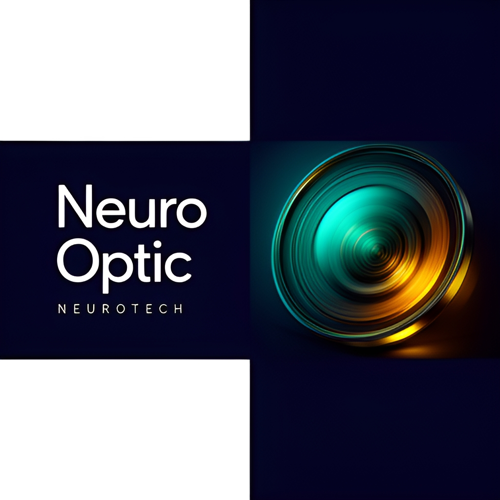

# NeuroOptic

<!-- aegean:media:start -->
<p align="center"></p>
<p align="center"><a href="LICENSE"></a> <a href="https://github.com/AegeanWorks/AIKit"></a></p>
<!-- aegean:media:end -->

NeuroOptic is a research-grade visual oscillator for brainwave entrainment: configurable 1-120 Hz
frequencies, hardware-aware safety limits and drift-free phase accumulation.

## ⚡ 30-Second Cold-Start Quick Reference

- **Runtime Prerequisites**: Python 3.10+ with `glfw`, `PyOpenGL`, `numpy` and `customtkinter` (see `requirements.txt`).
- **Canonical Regression Shield Gate**:
  ```bash
  python -m unittest discover
  ```

### 🛠️ AIKit Commands (run from the AIKit folder)
| Role | Command |
|---|---|
| Status, task and gates | `python aikit.py status NeuroOptic` |
| Phase 4: every gate | `python aikit.py check NeuroOptic` |
| Repair memory and map, then check | `python aikit.py fix NeuroOptic` |
| Resume an interrupted task | `python aikit.py resume NeuroOptic` |

## 📦 What's Inside

```text
NeuroOptic/
├── .gitignore                 <- transient AIKit state excluded
├── README.md
├── assets/
├── COMMERCIAL.md
├── LICENSE
├── LICENSES/                 <- REUSE license texts
├── REUSE.toml                <- Machine-readable SPDX metadata
├── entrainment_engine.py      <- GLFW/OpenGL entrainment engine and CLI
├── launcher.py                <- customtkinter GUI controller
├── requirements.txt
├── test_entrainment_engine.py <- unit tests for the engine's pure logic
└── .aikit/                    <- this project's memory: record, ledger, decisions, map
```

## Generalized Visual Entrainment Engine

NeuroOptic is a research-grade visual oscillator designed for precise brainwave entrainment. It supports configurable frequencies (1–120 Hz) with hardware-aware safety limits and drift-free phase accumulation.

### Features

*   **Precision Oscillator**: 0.01 Hz resolution using a monotonic high-resolution clock.
*   **Hardware-Aware**: Automatically detects monitor refresh rates and enforces Nyquist safety limits (e.g., Max 30Hz on a 60Hz screen).
*   **Waveforms**:
    *   **Sine**: Physiological oscillatory mimicry (Default).
    *   **Square**: Strong entrainment (Binary On/Off).
    *   **Triangle**: Linear fade in/out.
    *   **AM Carrier**: High-frequency carrier modulated at target frequency.
*   **Stimulation Modes**:
    *   **Full Screen**: Standard entrainment.
    *   **Split Hemifield**: Independent Left/Right control for binocular beats or lateralized stimulation.
    *   **Peripheral Ring**: Foveal sparing stimulation.
    *   **Quadrants**: Retinotopic mapping support (Top-Left, Bottom-Right, etc.).
*   **Research & Sham Control**:
    *   **Detune**: Frequency drifts slightly to prevent entrainment.
    *   **Low Amp**: Sub-threshold intensity.
    *   **Jitter**: Randomized phase timing.
    *   **Static**: Non-flickering control.
*   **Tech Stack**: Python, GLFW, OpenGL (VSync enabled).

### Installation

1.  Install dependencies:
    ```bash
    pip install -r requirements.txt
    ```

### Usage

#### Graphical Interface (Recommended)
Launch the GUI controller:
```bash
python launcher.py
```

#### Command Line Interface
Run the engine via command line:

```bash
# Default (40Hz Gamma, Sine wave)
python entrainment_engine.py

# Custom Frequency (e.g., 10Hz Alpha)
python entrainment_engine.py --freq 10.0

# Square Wave (Strong entrainment)
python entrainment_engine.py --freq 40.0 --waveform square

# Amplitude Modulated
python entrainment_engine.py --freq 40.0 --waveform am

# Split Hemifield (Binocular Beats: Left 10Hz, Right 11Hz)
python entrainment_engine.py --mode split --freq 10.0 --freq-right 11.0

# Research Mode (Sham: Detuned Frequency)
python entrainment_engine.py --freq 40.0 --sham detune

# Session Control (10 min session, 5s ramp-up)
python entrainment_engine.py --duration 600 --ramp 5.0
```

<!-- aegean:brand-assets:start -->
## 🎨 Brand Assets

> **AI-Generated Brand Artwork.** The banner and logo are **AI-generated brand assets**. They are illustrative and may not literally depict every feature or the full project scope.
<!-- aegean:brand-assets:end -->

## 📜 License

Free for personal use under the Aegean License 1.1 (AL-1.1); see [LICENSE](LICENSE). Any commercial use needs the Aegean Commercial License 1.0 (ACL-1.0); see [COMMERCIAL.md](COMMERCIAL.md).
